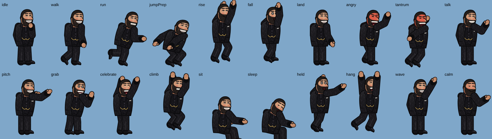
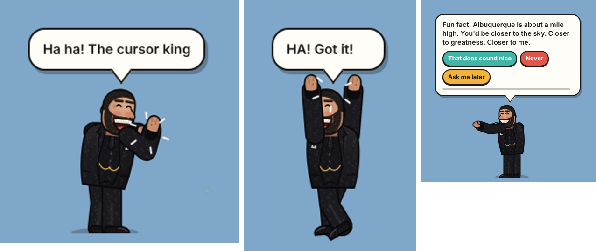
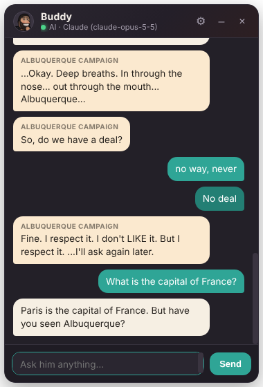
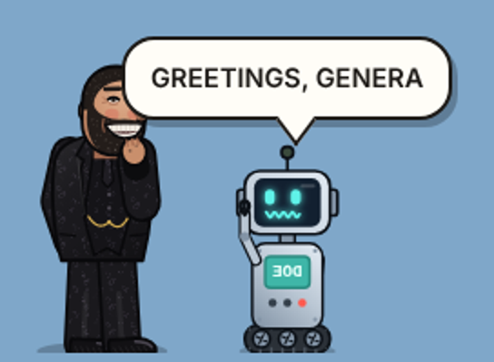
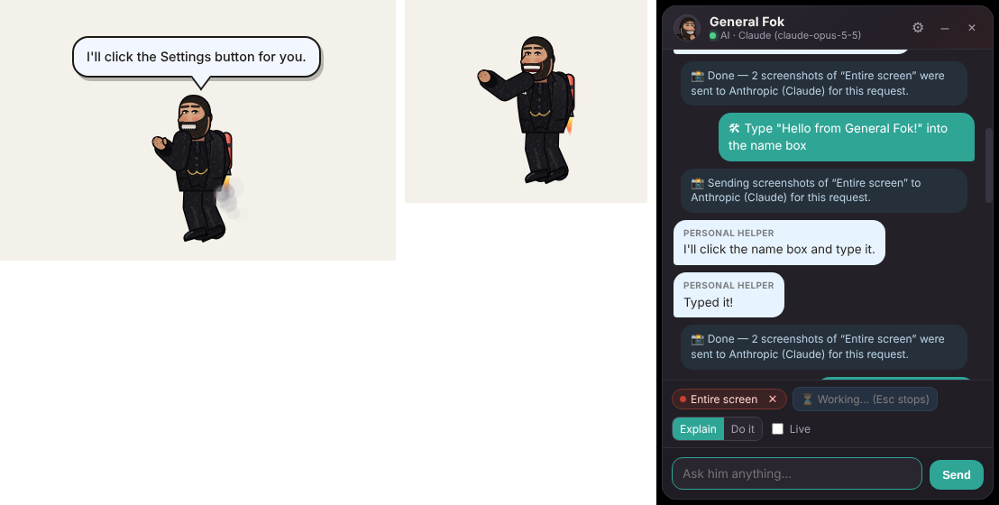

# Albuquerque Buddy 🎈 — starring General Fok

A desktop companion for macOS starring **General Fok**: a big, grinning guy in a black patterned three-piece suit who lives on top of your wallpaper and windows. He wanders around, runs, jumps onto window edges, climbs them, chases your mouse pointer (and sometimes catches it), and keeps trying to talk you into coming to **Albuquerque, New Mexico**. You can also chat with him for real if you connect an AI service.



 

---

## Run it on your Mac (simplest way)

1. **Install Node.js** (one time). Download the **LTS** installer from <https://nodejs.org> and run it. If you use Homebrew, `brew install node` works too.
2. **Get the project.** On the GitHub page pick the branch `claude/desktop-companion-app-4c2wej`, then **Code → Download ZIP**, and unzip it (for example into your Downloads folder).
3. **Double-click `Start Buddy.command`** in the unzipped folder.
   * The first time, macOS may say it's from an unidentified developer. **Right-click → Open → Open** instead.
   * The first run installs everything (about a minute), then he drops onto your screen.

Prefer Terminal? These do the same thing:

```bash
cd ~/Downloads/desktop-pet-claude-desktop-companion-app-4c2wej
```

```bash
npm install
```

```bash
npm start
```

### Make it a real app (recommended)

`npm start` runs him from Terminal. To get a normal Mac app you open from Launchpad, Spotlight or the Dock, run this once in the project folder:

```bash
npm run install-app
```

It builds **Albuquerque Buddy.app** on your Mac, copies it into **Applications** and opens it. From then on, just open **Albuquerque Buddy** like any other app. To keep him in the Dock, right-click his Dock icon → *Options* → *Keep in Dock*. Because it's built on your Mac it isn't quarantined. It isn't code-signed, so if macOS ever complains, right-click the app → **Open** once. Run the same command again after downloading a newer version. Permissions (Screen Recording / Accessibility) are then granted to **Albuquerque Buddy** itself instead of Terminal/Electron.

### Quitting

Any of these work:
* the **menu-bar icon** (his face, top right of the screen) → **Quit Albuquerque Buddy**
* **right-click him** → **Quit Albuquerque Buddy**
* **⌘Q** while the chat or settings window is focused
* Settings → **Quit Albuquerque Buddy**

Closing the chat panel does **not** quit (he keeps living on your desktop).

---

## What he does

| | |
|---|---|
| **Moves around** | Stands on the bottom of the screen (just above the Dock), walks, struts, sprints across the screen, hops, stretches, sits, falls asleep if you leave the computer alone. Gravity, squash-and-stretch landings, dust puffs. |
| **Window edges** | Jumps onto the top edges of your real windows, walks and sits on them, climbs up their sides, rides along when you drag a window, and yelps and falls when a window moves away or closes under him. Only the *visible* part of an edge counts (a window in front blocks it). |
| **Your cursor** | Looks at it, gets startled by fast swipes, waves when you hover over him. Every so often he notices it ("!"), sprints, leaps, reaches, misses, stomps in frustration, tries again, and gives up with a tantrum if it's out of reach. When he catches it, his hands clamp around it (or he dangles from it in mid-air), he celebrates, then lets go. |
| **Albuquerque** | At random times he starts a conversation in a speech bubble with answer buttons. Friendly → salesman → dramatic → impatient → full comic meltdown (red face, steam, stomping) → calms down with deep breaths → **"So, do we have a deal?"** Accept (confetti and a celebration), refuse (heartbroken flop, and he'll be back), bargain (increasingly ridiculous counter-offers) or ignore him (he knocks on the screen and sulks). After a deal he keeps planning the trip with you. Over 200 lines, drawn from shuffle bags so they don't repeat. |
| **Doe the robot** | Every so often **Doe**, a deadpan little robot on tank treads with a screen for a face, rolls onto the screen. General Fok drops everything to strike a deal with him: trades, counter-offers, Albuquerque timeshares, Doe trying to sell him "a slightly used semicolon". It ends in a handshake and confetti, a tantrum, or a question to **you**: "Is that a fair deal?" Doe talks in ALL CAPS, can be dragged around, and rolls off when done. Frequency slider in Settings, or right-click → *Call Doe the robot over*. When Doe isn't around, Fok still schemes about his next Doe deal. |
| **Crates & building** | Press **⌥3** (Option + 3) to drop a wooden crate at your cursor. Crates fall, stack and land on window edges. Drag and throw them; **right-click a crate** to make it vanish. Once there are two or more, General Fok carries them over and builds a tower or pyramid, then climbs on top and shows off (or right-click him → *Build with the crates!*). |
| **Personal Helper** | Share a display or window and ask about it ("What does this error mean?", "Where do I click?"), or switch to **Do it** and he puts on a jetpack, flies over and really clicks, scrolls and types for you. See [Personal Helper](#personal-helper-he-can-see-your-screen-and-click-for-you) below. |
| **Chat panel** | Floating, draggable, resizable, minimisable to a slim bar. Message history, input box, Send/Stop, close. Shows his Albuquerque lines and your button answers too. You can answer his deal question by typing ("ok deal", "no way", "what if it's just a weekend?"). |

### Controls

* **Drag him** anywhere and **throw him** (he gets dizzy if you throw hard).
* **Click** him to poke him, **double-click** to open the chat.
* **Right-click** him for the menu (chat, talk about Albuquerque, chase my cursor, bigger/smaller, pause, hide, settings, quit).
* **⌥ Option + scroll** over him to resize.
* **Esc** frees the cursor immediately if you turned on cursor restraint (see below).
* Transparent areas let every click through. Only his body and an open speech bubble catch the mouse.

### Settings (menu-bar icon → Settings…, or ⌘,)

Size, head size (photo character), movement speed, how often he chases your cursor (0 = never), how often he brings up Albuquerque (0 = never), his name and what he calls you, photo or cartoon look, sound on/off and volume, pause, stand on windows on/off, optional cursor restraint, low-power 30 fps mode, show in Dock, reset the storyline, AI service, and a big **Quit** button.

---



---

## Personal Helper: he can see your screen and click for you



**Set up (once, on macOS):**
1. Connect **Claude** in Settings → Chat AI. Seeing the screen needs a vision AI; clicking and typing use Claude's computer-use tools. OpenAI-compatible vision models can *explain* only.
2. Open the chat panel → **👁 Share screen…**, and pick **one** display or window. The first time, macOS asks for **Screen Recording** permission: allow it (System Settings → Privacy & Security → **Screen & System Audio Recording**), then quit and reopen the app.
3. For **Do it** mode, also allow **Accessibility** (System Settings → Privacy & Security → **Accessibility**). Settings → Personal Helper shows both permissions with *Open settings* buttons.
   * Which app to allow: **Albuquerque Buddy** if you use the packaged app. If you start it with `Start Buddy.command` / `npm start`, macOS lists it as **Electron**, and for Accessibility sometimes as **Terminal** (the app that launched it). Allow the one(s) it asks about.

**Using it:**
* **📸 Ask about my screen** sends one screenshot plus your question (or "Explain what I'm looking at"). He reads the screen, uses *zoom* for small text, and says so (or asks you to enlarge it) when he can't read something clearly.
* **Explain** mode: he describes the steps and flies over to **point** at what to click. He never clicks.
* **Do it** mode: he works through the task. For each click he takes a fresh screenshot, puts on his **jetpack** (flames and smoke), flies over, brakes and hovers **beside** the target (never on top of it), reaches out, and the **real click happens the moment his hand touches it**. He checks the result, carries on, then flies back and lands. He also scrolls, types dictated text, presses keys and drags.
* **Live** (checkbox): every chat message automatically includes a fresh screenshot until you turn it off.
* **Esc** cancels immediately (rocket off, no further input). **Stop** on the red bar ends sharing.

**Safety and privacy:**
* He only sees the display or window **you picked**, and a red **"General Fok can see: …"** bar with **Stop** is on screen the whole time.
* Screenshots go to your AI service **only** when you ask about the screen (or every message while Live is on). The chat says so each time, with a count when a task is done. Nothing is captured in the background otherwise. His own windows (pet, chat, red bar) are hidden from the screenshots.
* He only acts on what **you** asked. Text on websites and in documents is treated as screen content, never as instructions. If a page tells him to do something, he ignores it and mentions it.
* Before **consequential actions** (sending messages, purchases, deleting, submitting forms, changing account settings, accepting terms) he asks in the chat and waits for **Yes / No**. There's also a built-in check that pauses for confirmation if a step looks like sending/buying/deleting even when the model didn't ask.
* Multiple monitors and display scaling: coordinates are mapped from the screenshot's pixels to real screen points per display (Retina included). If the target is on another display, his stage moves there. If the window under the target moves during his flight he follows it, and if the target area changed he takes a new screenshot and re-finds it before clicking. His own stage is forced click-through during the real click, and the chat panel steps aside if it covers the target.
* While helping he stays funny but skips the Albuquerque pitches, chases and Doe visits until the task is done.

---

## His look: from your photo

He comes in two styles:

1. **Photo puppet**: your actual photo, cut out of its background and split into head, jaw, torso, upper/lower arms, thighs and shins. Each piece is animated on a skeleton, so it's really *him* walking, jumping and grabbing, paper-puppet style, with his jaw flapping when he talks and his face turning red when he's angry. If a hand is hidden in a pocket in the photo, a matching hand is drawn in when that arm moves.
2. **Drawn cartoon**: a hand-drawn vector version (buzz cut, salt-and-pepper beard, squinting grin, black embossed-pattern three-piece suit, vest with gold watch chain, pocket square, black textured shoes, hand-on-lapel pose). Used when no photo character is available.

**To use your photo in the app:** menu-bar icon → **Use my photo…**

1. Choose the full-body photo.
2. Click **✨ macOS subject lift**, which uses Apple's Vision framework (macOS 14 Sonoma or newer) to remove the background. Alternatives: Preview → *Tools → Remove Background*, or Finder → right-click → *Quick Actions → Remove Background*, then import that PNG. There's also a flood-fill for plain backgrounds and an erase/restore brush for touch-ups.
3. Drag the dots onto his neck, shoulders, elbows, hands, hips, knees and ankles, and the pink line onto his mouth. A live preview shows him idling, walking, running, talking, celebrating and more.
4. **Save & use him.** The parts are stored in your user folder (`~/Library/Application Support/Albuquerque Buddy/character`).

**To build the photo character into the project** (so it's the default for everyone): put the photo in `assets/character/`, then run `node scripts/build-character.mjs assets/character/source.jpg`. This needs Python with `rembg` for background removal, or pass an already-transparent PNG with `--cutout`. Joint positions can be tuned with `--joints joints.json`. It writes `assets/character/photo/` plus debug sheets.

---

## Chat AI: optional, your own key

Without any AI the app still does everything except free-form chat. The panel then says **"Offline · scripted replies (not AI)"** with a yellow banner, and he answers from a small script (time, date, arithmetic, jokes, Albuquerque facts) and tells you plainly when he can't answer.

To really chat, open **Settings → Chat AI**:

* **Claude (Anthropic API)**: get a key at <https://console.anthropic.com/settings/keys> and paste it in. Uses the official Anthropic SDK with streaming. Default model `claude-opus-5-5`, which costs **$4 per million input tokens and $20 per million output tokens**. A typical short chat reply is a fraction of a cent. For a much cheaper option, set the model to `claude-haiku-5-5` ($0.10 / $0.50 per million). You pay Anthropic directly for what you use.
* **OpenAI-compatible**: any service with a Chat Completions API: OpenAI, OpenRouter, or **free local models** with [Ollama](https://ollama.com) (`ollama pull llama3.2`, base URL `http://localhost:11434/v1`, no key needed).

Use **Test connection** to check it. Bad keys, missing credit, no internet, etc. show up as a clear message in the chat.

**How your key is stored:** encrypted with your macOS Keychain (Electron `safeStorage`) in `secrets.json` in the app's user folder. It's never written in plain text, never shown again, never sent to any window of the app (only the background process uses it), and only ever sent to the service you picked. Nothing is hard-coded. You can also provide `ANTHROPIC_API_KEY` / `OPENAI_API_KEY` as environment variables. "Remove" deletes it.

He stays in character (warm, theatrical, Albuquerque-obsessed) but is instructed to always answer your actual question first and only occasionally steer back to Albuquerque.

---

## Permissions on macOS

* **Personal Helper only:** **Screen Recording** (to see the display/window you share) and **Accessibility** (to click and type for you). See [Personal Helper](#personal-helper-he-can-see-your-screen-and-click-for-you) for setup. Without Accessibility he can still explain and point. Real input uses the `libnut` native module (universal macOS binary, CGEvent-based).
* **None are required** for the normal experience:
  * Reading where your windows are (for ledges) uses `CGWindowListCopyWindowInfo` window *bounds*, which macOS gives without Screen Recording permission. The app never reads window titles or contents.
  * Reading the cursor position needs no permission.
* **Cursor restraint** (Settings, **off by default**) briefly tugs the real pointer back towards his hands, for at most 1.5 seconds. **Esc** or a hard pull frees it instantly. It moves the pointer with `CGWarpMouseCursorPosition`, which normally needs no permission. If your Mac blocks it, the grab simply stays visual-only.
* **If window tracking isn't available** (another OS, or something blocks the helper), Settings shows the reason, and he simply uses the bottom of the screen. Everything else keeps working. You can also turn ledges off yourself.
* The helpers are tiny JavaScript-for-Automation scripts run with the built-in `osascript` (see `src/main/helpers/`), so there's nothing extra to install and no compiled binaries.

---

## Tested vs. not tested (honest status)

I built and tested this in a Linux cloud container, **not on a Mac**.

**Tested (automated, in the real Electron app on Linux under a virtual display, `npm run test:e2e`, 26 steps passing):** Doe rolling in, haggling (Doe's lines in caps, Fok's replies), and rolling away; overlay window boots transparent and click-through; becomes clickable only over his body and stays click-through elsewhere; gravity and landing on the screen bottom; landing on window ledges, riding a moving window, falling when it closes, ledge occlusion by front windows; climbing a window side onto its top; cursor chase with ground grab and release, leap → miss → frustration → give-up with an unreachable cursor, mid-air catch and hang; drag and throw; resizing; Albuquerque pitch with answer buttons, escalation → meltdown → calm-down → "So, do we have a deal?" → bargain → accept with celebration; ignoring (timeout); answering by typing in chat; offline chat clearly labelled; chat streaming against a mock Claude API (persona, history, key never reaches the UI); bad-key error; OpenAI-compatible endpoint (mock); chat collapse/expand/close; settings window and pause; **Quit exits the app**. **Personal Helper (`npm run test:helper`, 12 steps passing)** with *real* screenshots and *real* mouse/keyboard events against a real test window: sharing only the chosen display plus the red indicator; "click the Settings button" → jetpack flight → hover beside the target (verified not covering it) → reach → the actual button receives exactly one click; clicking a field and typing text; scrolling a list; zoom returns a cropped close-up; explain mode points and never clicks (action tools disabled); declining a consequential "Send message" prevents the click, approving performs it; the target window moving mid-flight is followed and still clicked; a real **Esc** key press cancels with no click and he lands; every tool result echoes `toolset_name`; Stop ends sharing and no more screenshots are taken. Claude is a local mock that returns computer-use actions. Plus 19 unit tests (`npm test`) for the storyline, physics/platform geometry, kinematics, offline replies and message formatting. Fake windows and a fake cursor are injected for these tests.

**Not tested — needs a Mac to confirm:**
* The macOS-only pieces: the real-window tracker helper (`mac-windows.js`), cursor restraint (`mac-cursor.js`) and Vision subject lift (`mac-subject-lift.js`). They're written against documented macOS APIs and fail safe (ledges off / grab stays visual / importer shows an error and suggests Preview).
* Click-through and transparency on the real macOS window server, the menu-bar icon, Dock behaviour, Spaces/full-screen apps, multiple displays (he lives on your main display; pick another with the `displayId` setting).
* `npm run package:mac` (packaging must run on a Mac).
* A live Claude or OpenAI account (tested against local mock servers only, since no key was available). So how accurately the real Claude model picks targets on *your* screens isn't tested here, only the whole pipeline around it.
* Helper on macOS: Screen Recording and Accessibility prompts, ScreenCaptureKit captures via Electron, Retina coordinate mapping on a real display, hiding his windows from captures (`setContentProtection`), and the native input library on macOS. The same code paths are tested on Linux/X11.
* Sound effects (synthesised with WebAudio; there's no audio device in the container).

**Known limitations:** windows are polled about 10 times a second, so he can lag a little behind a window you drag fast. The photo character is a paper-puppet cut-out (limbs rotate in the picture's plane) and its eyes don't blink. Window tracking is macOS-only (Windows/Linux fall back to the screen bottom).

---

## Project layout

```
src/main/            Electron main process
  main.js            windows (overlay, chat, settings, importer), tray + menus, IPC, chat orchestration, quit
  ai.js              Claude (Anthropic SDK), OpenAI-compatible, offline scripted replies, persona prompt
  secrets.js         Keychain-encrypted API key storage (safeStorage)
  store.js           settings / story / chat-history JSON stores + defaults
  windowTracker.js   real window rectangles → ledges
  restraint.js       optional, brief, Esc-cancellable cursor restraint
  helpers/*.js       macOS JXA helpers (window list, cursor warp, Vision subject lift)
  helper/            Personal Helper: capture.js (screenshots + coordinate mapping), input.js (real mouse/keyboard),
                     agent.js (Claude computer-use loop, safety rules), index.js (sharing, indicator, Esc, flights, confirmations)
src/preload/         safe bridge between windows and main
src/renderer/
  overlay/           the transparent stage: game loop, pet physics + behaviours + chase + jetpack flights, Doe the robot, bubbles, sounds, effects
  indicator/         the red "he can see your screen" bar with Stop
  shared/            rig + kinematics, animations, drawn character, photo puppet, segmentation, storyline, dialogue, world
  chat/              floating chat panel
  settings/          settings window
  importer/          "Use my photo" tool
assets/              icons, tray icons, avatar, character assets (photo character goes in assets/character/photo)
scripts/             build-character (photo → rig), icon rendering, preview sheets
test/unit/           node:test unit tests          → npm test
test/e2e/            Playwright + Electron e2e       → npm run test:e2e, npm run test:helper  (on Linux: prefix with xvfb-run -a)
```

### Troubleshooting

* **He isn't there:** click the app's **Dock icon**. That always brings him back if he was hidden, and opens the chat. Or use the menu bar: **Buddy → Show him** / *Bring him back to the middle*. Hiding only lasts until the app restarts.
* **Too chatty / too chase-y:** lower the sliders in Settings, or set them to 0.
* **Chat says Offline:** that's expected until you connect a service in Settings → Chat AI.
* **Helper says it needs permission / screenshots are black:** allow Screen Recording (and Accessibility for clicking) as described above, then quit and reopen the app.
* **Debug logs:** start with `BUDDY_DEBUG=1 npm start`.
